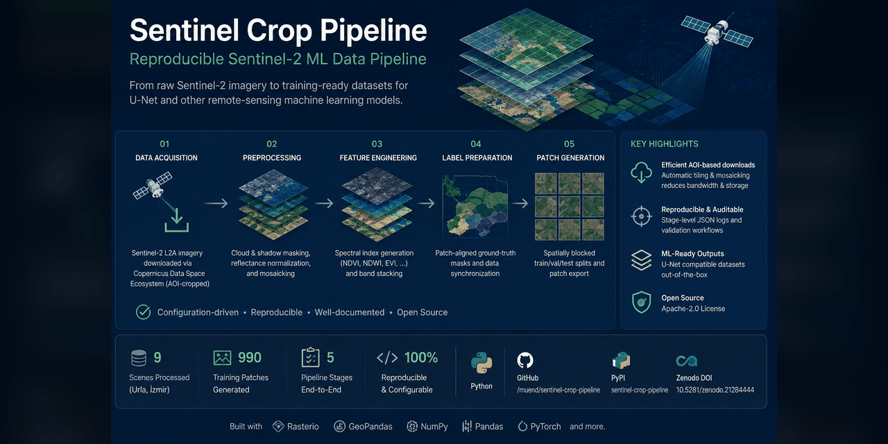
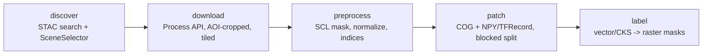

# sentinel-crop-pipeline
[](https://github.com/muend/sentinel-crop-pipeline)
[](https://github.com/muend/sentinel-crop-pipeline/actions/workflows/ci.yml)
[](https://pypi.org/project/sentinel-crop-pipeline/)
[](https://pypi.org/project/sentinel-crop-pipeline/)
[](LICENSE)
[](https://doi.org/10.5281/zenodo.21284444)

**A reproducible Sentinel-2 data preparation pipeline for crop-classification research.**

`sentinel-crop-pipeline` prepares Copernicus/CDSE Sentinel-2 L2A imagery for downstream crop-classification models. It handles scene discovery, AOI-cropped download, cloud/shadow masking, spectral preprocessing, fixed-size patch generation, spatially blocked train/validation/test splits, and patch-aligned ground-truth label masks.

The package is designed for research workflows where the model-training repository should consume clean, auditable, geospatially consistent image/label pairs instead of reimplementing the remote-sensing data pipeline.

> **Scope:** this repository prepares training-ready data only. Model training, model evaluation, inference, and final prediction maps are intentionally kept downstream.

The project was developed for a **TÜBİTAK 2209-A crop mapping study in İzmir/Urla**, but the workflow is configurable and reusable for other Sentinel-2 agricultural study areas.

---

## Contents

- [Why this project exists](#why-this-project-exists)
- [What the pipeline does](#what-the-pipeline-does)
- [Installation](#installation)
- [Credentials](#credentials)
- [Quickstart](#quickstart)
- [Validated live run](#validated-live-run)
- [Pipeline architecture](#pipeline-architecture)
- [Configuration](#configuration)
- [Scene selection](#scene-selection)
- [Preprocessing](#preprocessing)
- [Patch generation and spatial split](#patch-generation-and-spatial-split)
- [Ground truth and labels](#ground-truth-and-labels)
- [Outputs](#outputs)
- [Review dashboard](#review-dashboard)
- [Examples](#examples)
- [Development](#development)
- [Project status](#project-status)
- [Known limitations](#known-limitations)
- [Citation](#citation)
- [Contributing](#contributing)
- [License](#license)

---

## Why this project exists

Remote-sensing crop-classification studies often become difficult to reproduce before the model stage. Common problems include:

- undocumented scene selection;
- relying only on scene-level cloud metadata;
- downloading full SAFE products when only an AOI window is needed;
- inconsistent cloud/shadow masking;
- patch-level random splits that leak spatial information;
- image patches and ground-truth masks that are not perfectly aligned;
- missing audit logs for methodology reporting.

This repository focuses on solving that data engineering layer.

The goal is not to provide a new deep-learning architecture. The goal is to provide a reliable, restartable, auditable data pipeline that produces clean input for downstream CNN/U-Net or other crop-classification models.

---

## What the pipeline does

```text
discover -> download -> preprocess -> patch -> label
```

| Stage | Purpose | Main output |
|---|---|---|
| `discover` | Search Sentinel-2 L2A scenes and apply deterministic selection rules | `data/catalog/scenes.json`, `logs/selection_results.json` |
| `download` | Download AOI-cropped Sentinel-2 stacks through CDSE Process API | `data/raw/<scene>.tif` |
| `preprocess` | Apply SCL masking, normalization, and spectral indices | `data/interim/<scene>_stack.tif` |
| `patch` | Generate fixed-size COG/NPY/TFRecord patches and spatial splits | `data/patches/index.csv` |
| `label` | Rasterize crop polygons into patch-aligned label masks | `data/patches/labels/` |

Key capabilities:

- CDSE-first Sentinel-2 L2A workflow;
- AOI-cropped download instead of full SAFE products;
- automatic tiling and mosaicking for large AOIs;
- SCL-based cloud, shadow, cirrus, snow, and invalid-pixel masking;
- reflectance normalization;
- NDVI, NDRE, and NDWI support when required bands are available;
- georeferenced COG/TIFF patches for QGIS inspection;
- NPY and optional TFRecord training exports;
- spatially blocked train/validation/test assignment;
- GeoJSON/Shapefile parcel labels;
- manual CKS import support with no scraping;
- per-stage JSON audit logs;
- optional local read-only Streamlit dashboard.

---

## Installation

### From PyPI

```bash
pip install sentinel-crop-pipeline
```

With `uv`:

```bash
uv pip install sentinel-crop-pipeline
```

Optional extras:

```bash
pip install "sentinel-crop-pipeline[dashboard]"   # Streamlit review UI
pip install "sentinel-crop-pipeline[ai]"          # Gemini scene judge
pip install "sentinel-crop-pipeline[claude]"      # Claude scene judge
pip install "sentinel-crop-pipeline[gee]"         # optional GEE provider
pip install "sentinel-crop-pipeline[shapefile]"   # Shapefile label input
pip install "sentinel-crop-pipeline[tfrecord]"    # TFRecord export
```

### From source

```bash
git clone https://github.com/muend/sentinel-crop-pipeline.git
cd sentinel-crop-pipeline

python -m venv .venv
source .venv/bin/activate      # Windows: .venv\Scripts\activate

pip install -e ".[dev]"
pytest
```

---

## Credentials

STAC search can run without credentials in metadata-only mode. Downloads and SCL pixel checks require CDSE/Sentinel Hub OAuth credentials.

1. Create a free Copernicus Data Space Ecosystem account:
   `https://dataspace.copernicus.eu/`

2. Create an OAuth client:
   `https://shapps.dataspace.copernicus.eu/dashboard/`

3. Copy the environment template:

```bash
cp .env.example .env
```

4. Fill in:

```bash
CDSE_CLIENT_ID=...
CDSE_CLIENT_SECRET=...
```

Optional AI scene review keys:

```bash
GEMINI_API_KEY=...
ANTHROPIC_API_KEY=...
```

The pipeline works without AI keys. If AI review is disabled, unavailable, rate-limited, or fails, the pipeline continues with deterministic layer-1 rules and marks relevant scenes as `needs_manual_review`.

---

## Quickstart

After installation, the package provides the `sentinel-crop` command:

```bash
sentinel-crop --help
```

Run the stages one by one:

```bash
# 1. Discover candidate Sentinel-2 scenes
sentinel-crop discover --config config/default.yaml

# 2. Download AOI-cropped Sentinel-2 stacks
sentinel-crop download --config config/default.yaml

# 3. Apply SCL masking, normalization, and spectral indices
sentinel-crop preprocess --config config/default.yaml

# 4. Generate fixed-size patches and spatially blocked splits
sentinel-crop patch --config config/default.yaml

# 5. Rasterize parcel polygons into patch-aligned label masks
sentinel-crop label --config config/default.yaml
```

Run stages 1-4 in sequence:

```bash
sentinel-crop run-all --config config/default.yaml
```

`label` is intentionally not included in `run-all`, because parcel boundaries and ground-truth crop labels usually arrive later in the research workflow.

The module form is also supported:

```bash
python -m sentinel_crop_pipeline.cli discover --config config/default.yaml
```

---

## Validated live run

For the newer Google Colab/Drive technical pilot, see
[notebooks/README.md](notebooks/README.md). The notebooks include authentication,
small-window download, checksum-verified persistence, and RGB preview.
Their historical pilot AOI is not an approved agricultural study area. Verify
field locations before collecting research imagery; field coordinates, boundary
drafts, and private research notes remain local and are excluded from Git.

For a smaller live trial over the interim Urla AOI, use the subset configuration:

```bash
sentinel-crop run-all --config config/urla_june_subset.yaml --yes
```

This low-volume validation run documents the pipeline against live CDSE APIs over June 2025:

- 9 Sentinel-2 L2A scenes discovered;
- AOI-cropped download through CDSE Process API;
- large AOI split into sub-tiles and mosaicked;
- 9 preprocessed float32 stacks;
- 990 training patches generated;
- spatially blocked train/validation/test assignment.

See the full run note:

```text
docs/validation-run.md
```

---

## Pipeline architecture



Stages communicate through files on disk. This makes the workflow restartable: if one stage fails, previous outputs remain available and the failed stage can be re-run independently.

Design principles:

- keep runtime behavior config-driven;
- preserve georeferencing at every stage;
- mask invalid pixels instead of deleting them;
- avoid spatial leakage in train/test splits;
- keep permission-gated agricultural data manual-import only;
- log decisions and summaries for methodology reporting;
- keep the dashboard read-only and offline.

---

## Configuration

The pipeline is controlled through YAML configuration files.

Main configuration:

```text
config/default.yaml
```

Low-volume Urla validation subset:

```text
config/urla_june_subset.yaml
```

Important settings:

| Key | Purpose |
|---|---|
| `aoi.path` | AOI polygon path, GeoJSON, EPSG:4326 |
| `time.start` / `time.end` | date range for Sentinel-2 scene discovery |
| `time.crop` | optional crop-calendar key |
| `search.max_cloud_cover_pct` | scene-level metadata cloud-cover threshold |
| `scl_filter.max_invalid_pct` | pixel-level invalid-pixel threshold over AOI |
| `bands.base` / `bands.extra` | Sentinel-2 bands requested from CDSE |
| `preprocessing.indices` | spectral indices such as NDVI, NDRE, NDWI |
| `patching.patch_size` | output patch size in pixels |
| `patching.stride` | patch stride in pixels |
| `patching.block_factor` | spatial block size for split grouping |
| `labeling.source` | `vector` or `cks` |
| `labeling.vector_path` | path to crop polygons |
| `labeling.attribute` | crop-label attribute in polygons |
| `split.train` / `split.val` / `split.test` | target split ratios |

---

## Scene selection

Scene selection has two layers.

### Layer 1: deterministic rules

Layer 1 is always available and does not require AI keys:

- metadata cloud-cover threshold;
- crop-calendar date window;
- AOI overlap percentage;
- pixel-level SCL invalid-pixel check.

Pixel-level SCL checking is important because a scene may pass the global metadata cloud filter while still being cloudy or shadowed over the actual AOI.

### Layer 2: optional AI review

Optional visual review can evaluate RGB scene previews:

```yaml
ai_review:
  judge_provider: gemini   # gemini | claude | none
```

Install Gemini support:

```bash
pip install "sentinel-crop-pipeline[ai]"
```

Install Claude support:

```bash
pip install "sentinel-crop-pipeline[claude]"
```

AI review is deliberately conservative. Missing keys, missing SDKs, rate limits, timeouts, or malformed responses never stop the pipeline and never auto-reject scenes. Instead, the scene is flagged for manual review.

Selection decisions are written to:

```text
logs/selection_results.json
```

---

## Preprocessing

The preprocessing stage reads downloaded Sentinel-2 stacks and writes float32 GeoTIFFs.

It performs:

- SCL-based invalid-pixel masking;
- `NaN` masking for cloud/shadow/snow/invalid pixels;
- reflectance normalization;
- spectral index generation;
- `MASK` band creation.

Example output bands:

```text
B02 B03 B04 B08 NDVI MASK
```

If an index requires a missing band, it is skipped with a warning. For example, NDRE requires red-edge bands such as `B05`.

---

## Patch generation and spatial split

The `patch` stage creates fixed-size training patches from preprocessed stacks.

Outputs include:

- georeferenced COG/TIFF patches for visual inspection;
- `.npy` arrays for model training;
- optional TFRecord files;
- sidecar metadata;
- a patch manifest at `data/patches/index.csv`.

The split is group-aware over spatial blocks, not random per patch.

Each patch receives a stable `spatial_block_id` based on CRS and world-grid position. Whole blocks are assigned to a single split. This reduces a common remote-sensing evaluation problem: neighbouring or overlapping patches appearing in both train and test sets, which can inflate metrics through spatial autocorrelation.

---

## Ground truth and labels

For imagery containing only field pixels, use the
[field-only workflow](docs/field-only.md) and `config/urla_fields.yaml`.
It combines private polygon boundaries with SCL masking, removes boundary
pixels conservatively, and rejects unmasked/background training windows.

The `label` stage reads crop polygons and rasterizes them onto the exact patch grid.

Supported sources:

| Source | Description |
|---|---|
| `vector` | GeoJSON by default; Shapefile with optional extra |
| `cks` | manual import of officially obtained CKS exports |

GeoJSON configuration:

```yaml
labeling:
  source: vector
  vector_path: data/labels/parcels.geojson
  attribute: crop_type
```

Shapefile support:

```bash
pip install "sentinel-crop-pipeline[shapefile]"
```

Outputs:

```text
data/patches/labels/
data/patches/labels/class_map.json
```

Background is class `0`. Crop classes start from `1`.

CKS data is not fetched automatically. It must be obtained through the proper institutional/legal process and placed manually under the configured import directory.

---

## Outputs

```text
data/
  catalog/
    scenes.json                  accepted scenes from discover

  raw/
    <scene>.tif                  AOI-cropped uint16 stack, bands + SCL

  interim/
    <scene>_stack.tif            float32 stack, NaN-masked, indices + MASK

  patches/
    cog/                         georeferenced patch TIFF/COG files
    train/                       NPY or TFRecord training arrays
    labels/                      uint8 label masks + class_map.json
    index.csv                    patch manifest, split, paths, invalid fraction

logs/
  run_<stage>_<timestamp>.json   per-stage run summaries
  selection_results.json         per-scene selection decisions
```

The patch manifest is the main handoff file for downstream model-training repositories.

---

## Review dashboard

Install dashboard dependencies:

```bash
pip install "sentinel-crop-pipeline[dashboard]"
```

Run from the repository root:

```bash
streamlit run src/sentinel_crop_pipeline/dashboard/app.py
```

The dashboard is local, single-user, and read-only.

It shows:

- scene footprint map;
- accepted/rejected/manual-review scene status;
- cloud and SCL statistics;
- patch browser;
- RGB and label overlay;
- spatial split map;
- run history from JSON logs.

The dashboard only reads files already on disk. It does not call CDSE, Gemini, Claude, or any external API.

---

## Examples

The `examples/` directory contains small reference outputs:

```text
examples/
  selection_results.example.json
  index.example.csv
  sample_parcels.geojson
```

Use the sample parcels to try the label stage:

```yaml
labeling:
  vector_path: examples/sample_parcels.geojson
```

Then run:

```bash
sentinel-crop label --config config/default.yaml
```

The sample parcels are synthetic and are not real ground truth.

---

## Development

Clone the repository:

```bash
git clone https://github.com/muend/sentinel-crop-pipeline.git
cd sentinel-crop-pipeline
```

Create a virtual environment:

```bash
python -m venv .venv
source .venv/bin/activate      # Windows: .venv\Scripts\activate
```

Install in editable mode:

```bash
pip install -e ".[dev]"
```

Run tests:

```bash
pytest
```

The test suite uses mocks and synthetic rasters. Tests should not require network access or external credentials.

---

## Project status

Current package status: **beta research software**.

Implemented:

- PyPI package;
- Zenodo DOI;
- CDSE provider;
- Sentinel-2 L2A scene discovery;
- AOI-cropped Process API download;
- tiled download and mosaic path;
- OData fallback;
- SCL masking;
- spectral preprocessing;
- patch generation;
- COG, NPY, and TFRecord export;
- spatially blocked split;
- vector and manual CKS label sources;
- patch-aligned label masks;
- run logs and selection audit records;
- optional AI scene review;
- optional read-only dashboard;
- CI and test suite.

Out of scope for this repository:

- model training;
- model evaluation;
- inference over unseen scenes;
- final prediction map production;
- automatic CKS access or scraping;
- hosted multi-user dashboard.

---

## Known limitations

- The default Urla AOI is an interim rectangle, not an official district boundary.
- GEE provider support is currently search-only.
- Live AI judge validation is optional and not required for the deterministic pipeline.
- The label stage depends on externally prepared ground-truth polygons.
- Spatial blocks are grid cells, not agronomic field units. Larger `block_factor` values reduce residual leakage risk when fields cross block boundaries.
- The package prepares data for downstream models; it does not guarantee model accuracy by itself.

---

## Citation

If you use this software, cite it using the Zenodo DOI:

```bibtex
@software{duran_sentinel_crop_pipeline,
  title  = {sentinel-crop-pipeline: a reproducible Sentinel-2 data preparation pipeline for crop classification},
  author = {Duran, Muhammed Enes},
  doi    = {10.5281/zenodo.21284444},
  url    = {https://github.com/muend/sentinel-crop-pipeline}
}
```

See also:

```text
CITATION.cff
```

---

## Contributing

Contributions are welcome for:

- bug fixes;
- documentation improvements;
- additional data providers;
- additional scene judges;
- preprocessing utilities;
- tests and examples.

Please read:

```text
CONTRIBUTING.md
```

Ground rules:

- keep tests network-free;
- do not commit credentials;
- keep runtime behavior config-driven;
- do not add automated scraping for permission-gated agricultural datasets;
- document major design changes before changing established behavior.

---

## License

This project is licensed under the **Apache License 2.0**.

Sentinel-2 data is Copernicus Sentinel data. See the Copernicus Sentinel data legal notice for data-use terms.
