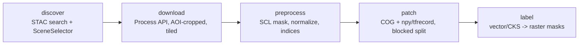

# Architecture

## Pipeline



Stages communicate only through files (`data/catalog/scenes.json`,
`data/raw/`, `data/interim/`, `data/patches/`), so each stage can be re-run or
fixed independently.

## Modules

```
src/sentinel_crop_pipeline/
  discovery/
    providers/base.py       DataProvider ABC + Scene dataclass
    providers/cdse.py       STAC search, OAuth2, tiled Process API, OData fallback
    providers/gee.py        optional GEE provider (search-only)
    providers/registry.py   config name -> provider
    scene_selector.py       layer-1 rules + layer-2 judge, SelectionResult
    judge.py                SceneJudge ABC, GeminiFlashJudge, ClaudeJudge
  preprocessing/
    scl_mask.py             SCL valid mask / invalid fraction
    resample.py             20m -> 10m grid resampling
    normalize.py            reflectance | minmax
    indices.py              NDVI, NDRE, NDWI
    pipeline.py             per-scene orchestration
  patching/
    tiler.py                windowing, invalid filter, spatial-block split
    export.py               COG / npy / TFRecord writers
  labeling/
    base.py                 LabelSource ABC
    vector.py               GeoJSON/Shapefile parcels
    cks.py                  CKS manual import connector (no scraping)
    rasterize.py            polygons -> patch-aligned uint8 masks
  dashboard/
    data.py                 read-only loaders/parsers (no Streamlit import)
    app.py                  Streamlit UI (optional extra, run via streamlit)
  utils/                    config, .env, geo helpers, run logger
  cli.py                    discover | download | preprocess | patch | label | run-all
```

## Design decisions

- **CDSE default.** Consistent with the declared methodology, ESA/EU-run, no
  Google account. GEE stays optional because its registered-Cloud-project
  requirement (post-2024) breaks one-command setup.
- **AOI-cropped, tiled downloads.** The Process API returns only the AOI
  window (tens of MB) instead of full SAFE products (~1 GB). AOIs above the
  2500 px/axis API limit are split into sub-tiles on the UTM grid and
  mosaicked with rasterio.merge; output CRS is the local UTM zone.
- **Mask, don't delete.** Cloud/shadow pixels become NaN and a MASK band is
  appended. Scene grids stay aligned for time-series stacking.
- **Spatially blocked split.** Patches carry a `spatial_block_id` (fixed world
  grid, cell side = block_factor x patch size); whole blocks go to one split
  via seeded deficit-greedy assignment. Random patch-level splits let spatial
  autocorrelation inflate test metrics; this design prevents train/test
  leakage between neighbouring patches by construction, verified by a unit
  test.
- **Judge plugin layer.** Layer-2 review mirrors the provider plugin pattern.
  Gemini Flash-Lite is default for free-tier access; Claude optional. No quota
  numbers hardcoded (they change monthly) — 429s get exponential backoff, and
  any failure degrades to needs_manual_review instead of stopping the run or
  auto-rejecting scenes.
- **Two-level patch output.** COG keeps georeference for QGIS inspection and
  reproducibility; npy/TFRecord is derived from the same array for direct
  Keras/TF input (NaN -> 0 there; use MASK in the loss).
- **Labels as rasters aligned to patches.** Vector parcels are reprojected to
  the patch CRS and burned per patch, so image/label pairs share transform and
  shape exactly. CKS has no automated access path by design (legal).
- **Selection transparency.** Every accept/reject decision, with per-check
  notes, judge verdict/confidence and needs_manual_review flags, lands in
  `logs/selection_results.json` — a methodology audit trail for reports.
- **Dashboard is read-only and offline.** The optional Streamlit app renders
  only files already under `logs/` and `data/` — no live CDSE/judge calls, so
  API keys can never leak through a dashboard session. Write-back (recording
  manual review decisions) is deliberately deferred to a future 6b phase.
  Parsing lives in `dashboard/data.py` without Streamlit imports, so it is
  unit-tested without the `[dashboard]` extra.
- **STAC endpoint.** `https://stac.dataspace.copernicus.eu/v1` (collection
  `sentinel-2-l2a`), verified against the live catalog. Cloud cover is
  re-filtered client-side to tolerate deployments with partial query support.

## Field-only imagery (2026-11-09)

The Urla research workflow uses explicit private field polygons, rather than
accepting an entire rectangular download as agricultural imagery. A Process API
context window may be retained privately for location review; dataset outputs
must mask everything outside the supplied field boundaries.

With `download.field_only`, the rectangular API response is temporary. Only
per-field COGs, masks, and provenance are persisted to the raw dataset folder.
Field IDs are validated before network activity. This mode requires the
Process API path and an explicit field-mask file.

The preprocessing field-mask option combines geometric field membership with
SCL validity. Its conservative rule discards every pixel touching the polygon
boundary (including hole boundaries), keeping complete interior pixels only.
It appends `FIELD_MASK` and preserves `MASK` as the final combined validity band.
All optical/index values outside `MASK` are NaN. Dataset masks make NoData
explicit in GIS viewers. A separate local crop exporter produces a compact COG
for a single field, preserving the original resolution/grid and source checksum.

The field-only configuration requires `FIELD_MASK` during patching and requires
100% field coverage for accepted fixed-size patches. Unmasked historical stacks
must fail this check. Too-small fields can produce a valid per-field crop and
zero fixed-size training patches; images are never enlarged to invent detail.
Field boundaries and provenance remain private and ignored by Git. This
geometric mask does not infer crop type or establish reference-label accuracy.

## Assumptions / known limits

- The interim Urla AOI is a simplified bbox, not the official district
  boundary (OSM boundary services were unreachable from the build
  environment). Replace `data/aoi/urla_ilce_interim.geojson` when real
  parcels/boundary are available.
- Spatial blocks are grid cells, not agronomic units; a field straddling a
  block edge can still contribute pixels to two splits through different
  patches. Larger `block_factor` reduces this residual risk.
- SCL is requested at 20 m for the selection statistic; the download step
  resamples it to the band grid server-side.
- Live CDSE download/judge paths are implemented but not yet exercised with
  real credentials; unit/integration tests use mocks and synthetic rasters.
- GEE provider is search-only.
