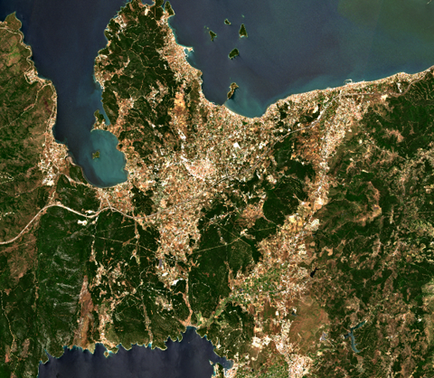
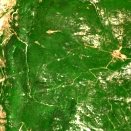
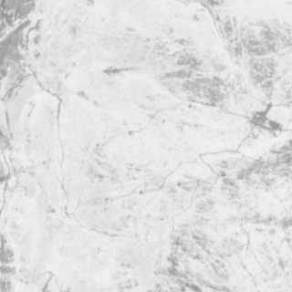

# Validated live run (2026-07-09)

End-to-end run of `discover -> download -> preprocess -> patch` against the
live CDSE APIs with real credentials, using `config/urla_june_subset.yaml`
(one month over the interim Urla AOI). This documents that the pipeline works
outside mocks; numbers below come from the `logs/run_*.json` audit files of
that run.

## Setup

- AOI: `data/aoi/urla_ilce_interim.geojson` (interim bbox, ~31 x 27 km,
  Urla district, Izmir)
- Window: 2025-06-01 .. 2025-06-30, cloud metadata < 20%, AOI overlap >= 60%,
  SCL invalid < 30%
- Bands: B02/B03/B04/B08 + SCL at 10 m, Process API (AOI-cropped, auto-tiled,
  mosaicked)
- Judge: `none` (layer-1 rules only; accepted scenes flagged
  `needs_manual_review` by design)

## discover

- STAC search returned 9 L2A scenes (all tile T35SMC, 3-5 day cadence)
- Layer 1 accepted 9/9; full per-check audit in
  `examples/selection_results.example.json`
- For contrast, the full-season run (2025-04..2025-10) found 48 scenes and
  rejected exactly one: S2C 2025-10-28 with `scl_invalid=49.1%` — a scene
  that passed the metadata cloud filter but failed the pixel-based SCL check,
  which is the reason that check exists.

## download

- Estimate reported before any data transfer: 9 x 81.9 MB = 737 MB;
  actual on disk: ~480 MB (9 files, ~53 MB each, deflate)
- Each stack: 5 bands (B02/B03/B04/B08/SCL), 3067 x 2672 px @ 10 m,
  EPSG:32635, identical grids across scenes (time-series ready)
- AOI exceeds the 2500 px/axis Process API limit, so each scene was fetched
  as 4 sub-tiles and mosaicked — this run validates the tiling path

*RGB quicklook of the 2025-06-02 scene (downsampled). SCL class shares for
this scene: 49.9% vegetation, 25.3% not-vegetated, 24.7% water, ~0% cloud.*

## preprocess

- 9/9 scenes processed: SCL classes {0,1,3,8,9,10,11} -> NaN + MASK band,
  reflectance normalization (DN/10000), NDVI appended
- NDRE skipped with a warning (B05 not in the band set — add `B05` to
  `bands.extra` to enable it)
- Output: float32 stacks, bands `B02 B03 B04 B08 NDVI MASK`

## patch

- 990 patches (9 scenes x 110), 256 x 256 px, none dropped by the 40%
  invalid-pixel filter (June scenes were essentially cloud-free)
- 9 spatial blocks (block side = 4 x 256 px); split by whole blocks:
  648 train / 180 val / 162 test (65.5 / 18.2 / 16.4%)
- The deviation from the configured 70/15/15 is expected: with 9 blocks the
  assignment is coarse, and block integrity takes priority over exact ratios
  (no spatial leakage by construction)

| Patch RGB | Patch NDVI |
|---|---|
|  |  |

*One 256 x 256 training patch (2.56 x 2.56 km at 10 m): RGB composite and its
NDVI band (bright = dense vegetation).*

## Not covered by this run

- `label` stage: real field parcels arrive later in the study; the stage is
  covered by unit/integration tests and can be tried with
  `examples/sample_parcels.geojson`
- AI judge (`gemini`/`claude`): implemented with graceful degradation,
  not yet exercised against the live API
- OData full-SAFE download fallback (`download.method: odata`)
